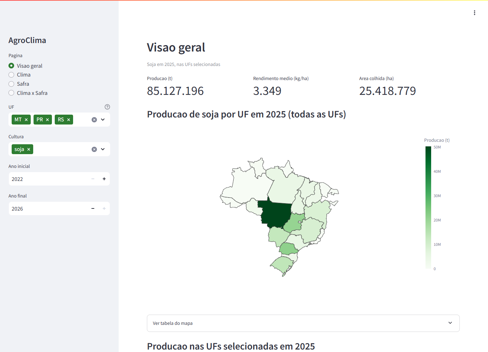
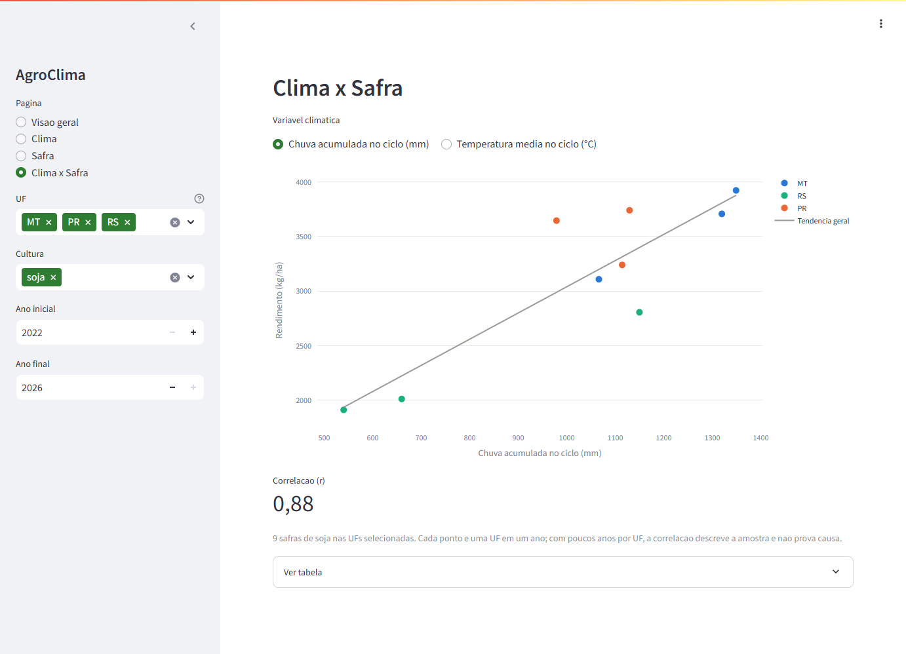

# AgroClima Analytics

Pipeline de dados que cruza clima e producao agricola no Brasil por estado.
Coleta dados do INMET e do IBGE, transforma em camadas Bronze/Silver/Gold e
disponibiliza em um dashboard interativo.

A pergunta que o projeto responde: como chuva e temperatura se relacionam com
a produtividade das principais culturas, por estado?



## O que o projeto faz

1. Baixa o historico horario das estacoes automaticas do INMET (2001-2026)
2. Busca area, producao e rendimento de soja, milho, cafe e cana no IBGE/SIDRA
3. Armazena os dados brutos em Parquet (Bronze)
4. Limpa e agrega o horario para diario por estacao com dbt (Silver)
5. Agrega por estado e mes, calcula medias moveis, anomalias e o clima de cada
   ciclo de safra com dbt (Gold)
6. Exibe os resultados num dashboard Streamlit
7. Treina um modelo que preve a anomalia de rendimento de cada safra a partir
   do clima do ciclo, e preve as safras que o IBGE ainda nao publicou

O Airflow agenda o processo todo dia as 09h UTC (06h no horario de Brasilia).

## Dashboard

- **Visao geral** - producao, rendimento e area de uma cultura, com mapa do
  Brasil por estado e comparacao entre os estados selecionados
- **Clima** - temperatura, media movel de 3 meses, chuva mensal e anomalia de
  temperatura por estado
- **Safra** - producao, rendimento e variacao anual por estado e cultura
- **Clima x Safra** - chuva ou temperatura acumulada no ciclo da cultura contra
  o rendimento, com a correlacao da amostra
- **Previsao** - mapa e barras com a anomalia prevista para as safras que o IBGE
  ainda nao publicou, o horizonte de cada previsao e o skill do modelo na
  validacao (le `data/modelos/`, gerado por `make treinar` e `make prever`)



## Site

O site publico em `web/` e a vitrine do projeto: uma home que conta o que os
dados mostram e duas paginas de exploracao, Clima e Safra. Ele le um extrato
estatico das tabelas Gold, versionado em `web/public/data`, e nao acessa o
DuckDB. O desenho esta em [docs/design-web.md](docs/design-web.md) e o README
proprio em [web/README.md](web/README.md).

O dashboard Streamlit continua sendo a ferramenta de analise local, com todas
as colunas e filtros; o site e o que se mostra para quem chega de fora.

```
make exportar-web   # regenera o extrato a partir do warehouse
make web-dev        # sobe o site em http://localhost:3000
make web-build      # gera o site estatico em web/out
```

O export nao roda na execucao diaria do Airflow. Publicar dado novo e uma
decisao deliberada: rodar `make exportar-web` e commitar o resultado.

## O que os dados mostram

Com os filtros padrao (soja em MT, PR e RS), a chuva acumulada no ciclo tem
correlacao de 0,88 com o rendimento. O numero e puxado pelo RS: as safras
2022/23 e 2024/25 tiveram 540 e 660 mm no ciclo e os menores rendimentos da
amostra. So com MT e PR a correlacao cai para 0,56; com todos os estados que
plantam soja (68 safras), fica em 0,10.

Ou seja, secas fortes aparecem nos dados, mas a chuva total do ciclo sozinha
nao explica o rendimento no pais. Irrigacao, distribuicao da chuva ao longo
do ciclo e diferencas de manejo entre regioes pesam, e o projeto nao mede
essas variaveis. A cada ano novo de dados a amostra cresce.

## Modelo

Alem da correlacao, o projeto treina um modelo que responde: dado o clima
observado ate agora no ciclo, quanto a safra vai render em relacao ao
esperado? O alvo e a anomalia de rendimento (log do rendimento menos a
tendencia dos 15 anos anteriores), e as variaveis sao chuva, temperatura e
dias secos de cada terco do ciclo, comparados com a normal do estado.

- Validacao temporal (rolling origin, um ano de teste por vez), com skill
  contra a tendencia e intervalo de confianca por bootstrap de anos
- Baselines (tendencia, persistencia, ridge) e ablacoes (sem clima, so clima,
  com 1/3 e 2/3 do ciclo observado)
- LightGBM com valores SHAP para explicar cada previsao
- Retreino no Airflow quando o dado muda, com portao de promocao: a versao
  nova so substitui a atual se nao piorar
- MLflow para tracking e model card para o Hugging Face Hub

```
make install-ml    # dependencias do modelo
make treinar       # avalia, treina e grava data/modelos/<versao>/
make prever        # preve as safras ainda nao publicadas
make mlflow        # interface do MLflow em http://localhost:5000
make publicar-hf REPO=usuario/agroclima-anomalia-rendimento
```

O relatorio da avaliacao fica em `data/modelos/atual/relatorio.md`. O desenho,
as escolhas e as limitacoes estao em [docs/ml.md](docs/ml.md).

## Tecnologias

- Python - ingestao
- dbt + DuckDB - transformacao, modelagem e testes
- Apache Airflow - agendamento
- Streamlit + Plotly - dashboard
- LightGBM + scikit-learn - modelo, com MLflow para tracking
- Docker - para rodar tudo junto

## Dados coletados

INMET (dados historicos das estacoes automaticas):

- temperatura, precipitacao, umidade e vento, por hora, agregados por estado

IBGE/SIDRA:

- PAM (tabela 5457): area plantada, area colhida, producao e rendimento anuais
- LSPA (tabela 6588): estimativas mensais da safra, usadas para conferir o
  milho da PAM

IBGE/malhas: contorno dos estados para o mapa, versionado em `dashboard/assets`.

## Como rodar

### Com Docker (inclui Airflow)

```
cp .env.example .env
docker compose up -d
```

- Dashboard: http://localhost:8501
- Airflow: http://localhost:8080 (usuario `admin`, senha definida em
  `AIRFLOW_PASSWORD` no `.env`; o padrao e `admin`)

Na primeira subida a DAG `agroclima_pipeline` ja roda uma vez: baixa cerca de
1,5 GB do INMET (2001 a 2026) e pode levar mais de uma hora. O dashboard mostra dados quando ela
termina. As execucoes seguintes verificam o ETag dos arquivos do INMET e so
baixam o que mudou, entao levam menos de um minuto.

O historico do Airflow fica no volume `airflow_estado` e sobrevive a
`docker compose down`. `docker compose down -v` apaga esse historico; os dados
baixados e o `warehouse.duckdb` ficam em `data/` e continuam la.

No Linux, acrescente o seu usuario ao `.env` antes de subir, para o container
conseguir escrever em `dbt/` e `data/`, que sao montados do host:

```
echo "AIRFLOW_UID=$(id -u)" >> .env
```

### Local (sem Docker)

```
python -m venv venv
venv\Scripts\activate
pip install -r requirements.txt
cd dbt && python -m dbt.cli.main deps && cd ..

python -m src.pipeline
python -m streamlit run dashboard/app.py
```

Acesse: http://localhost:8501

Para avaliar o projeto sem esperar o download do INMET, rode
`python scripts/seed_bronze_dev.py` antes: ele grava uma camada Bronze
fabricada e pequena, no mesmo formato da ingestao real, o suficiente para
rodar o dbt (`cd dbt && python -m dbt.cli.main build`) e abrir o dashboard.
O seed so tem DF, SP e MG; selecione esses estados no filtro.

`dbt` e `streamlit` sao chamados como modulo (`python -m ...`) porque, no
Python distribuido pela Microsoft Store, os console scripts desses pacotes
nao ficam expostos no PATH. Se o seu Python nao tiver essa limitacao, os
comandos `dbt` e `streamlit run` diretos tambem funcionam.

O Airflow nao roda nativamente no Windows; use o Docker para a parte de
agendamento.

### Testes

Instale tambem as dependencias de desenvolvimento (`pytest` e `responses`,
que nao entram nas imagens de producao). O `dbt deps` e necessario:
`test_pipeline_smoke.py` roda um `dbt build` de verdade sobre dados
fabricados e depende do pacote `dbt_utils`.

```
pip install -r requirements-dev.txt
cd dbt && python -m dbt.cli.main deps && cd ..
python -m pytest
```

A suite nao acessa a rede: as APIs sao simuladas e o dashboard e testado
contra um DuckDB temporario. Os testes do dbt verificam regras que valem para
qualquer dado e rodam tanto no seed quanto na base real. Por exemplo: a chuva
de um estado nunca passa do que a estacao mais chuvosa registrou em cada dia,
o que pega uma soma entre estacoes no lugar da media.

## Makefile

Atalhos para os comandos acima (`dbt` e `streamlit` continuam sendo
chamados como modulo, pelo mesmo motivo citado na secao anterior):

```
make install      # requirements.txt + dbt deps
make install-dev  # + requirements-dev.txt (pytest, responses)
make test         # python -m pytest -v
make pipeline     # python -m src.pipeline
make dbt          # cd dbt && dbt build
make dashboard    # streamlit run dashboard/app.py
make up           # docker compose up -d
make down         # docker compose down
make exportar-web # regenera web/public/data a partir do warehouse
make web-dev      # sobe o site em http://localhost:3000
make web-build    # gera o site estatico em web/out
```

## Estrutura

O desenho completo, com as decisoes e o porque de cada uma, esta em
[docs/design.md](docs/design.md).

- `src/ingestion` - clientes das APIs, gravam Parquet em `data/bronze`
- `scripts/seed_bronze_dev.py` - gera uma Bronze fake para desenvolvimento local
- `dbt/models/staging` - limpeza e padronizacao (Silver)
- `dbt/models/marts` - KPIs e cruzamentos (Gold)
- `dbt/tests` - testes singulares do dbt
- `dashboard` - aplicacao Streamlit
- `scripts/exportar_web.py` - extrai as tabelas Gold para `web/public/data`
- `web` - site publico em Next.js, estatico
- `airflow/dags` - agendamento
- `airflow/iniciar.sh` - partida do container do Airflow (usuario e dependencias do dbt)
- `requirements.txt` - dependencias para rodar local e o dashboard
- `src/ml` - modelo: alvo, variaveis, validacao, treino, previsao e publicacao
- `requirements-ml.txt` - `requirements.txt` mais o necessario para o modelo
- `requirements-dev.txt` - `requirements-ml.txt` mais `pytest` e `responses`,
  usadas so pela suite de testes
- `requirements-airflow.txt` - subconjunto usado na imagem do Airflow (sem
  streamlit/plotly/statsmodels, que sao so do dashboard e podem colidir com
  as constraints do apache/airflow)

## Limitacoes conhecidas

- A media climatica por estado nao e ponderada por area: estados grandes tem
  cobertura desigual de estacoes. O campo `n_estacoes` fica visivel no
  dashboard para o leitor julgar cada ponto.
- A API horaria do INMET (`apitempo`) esta fechada e retorna 204; o projeto
  usa os arquivos anuais de dados historicos, atualizados a cada ~90 dias.
- A anomalia climatica nao e calculada contra uma normal de 30 anos.
  `gold_clima_uf_mensal` tira a media de referencia da propria janela de
  2001-2026 que ele agrega, entao `anomalia_temp` e `anomalia_precip` sao o
  desvio em relacao a media desse periodo, nao a uma normal climatologica
  oficial. O modelo nao usa essas colunas: calcula as proprias normais so com
  anos anteriores.
- Safras com ciclo incompleto na base climatica nao aparecem em
  `gold_clima_safra`. O modelo so publica uma linha quando
  `meses_observados = meses_esperados`; um ano-safra cujo ciclo cai na
  borda da janela de clima disponivel ficaria com `precip_ciclo` calculado
  sobre uma fracao do periodo, mas apresentado como se fosse o total. Nao
  publicar a linha e preferivel a publicar um numero errado - por isso a
  pagina de Clima x Safra pode nao cobrir todos os anos que a pagina de
  Safra cobre. A safra de soja 2000/01, por exemplo, fica de fora porque o
  clima comeca em janeiro de 2001.
- A chuva de um mes so e publicada quando todos os dias tem medicao em alguma
  estacao do estado. Na base real isso deixa de fora cerca de 3% dos meses,
  quase todos em RR, SE e RO, e as safras cujo ciclo passa por eles.
- A correlacao da pagina Clima x Safra descreve a amostra selecionada, nao uma
  relacao de causa.

## Fontes

- [INMET Dados Historicos](https://portal.inmet.gov.br/dadoshistoricos)
- [IBGE API de agregados](https://servicodados.ibge.gov.br/api/docs/agregados?versao=3)
- [IBGE API de malhas](https://servicodados.ibge.gov.br/api/docs/malhas?versao=3)
